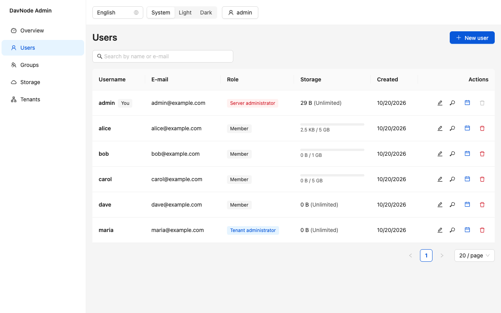

# DavNode

[](https://github.com/kaigothe/DavNode/actions/workflows/ci.yml)
[](https://github.com/kaigothe/DavNode/releases)
[](LICENSE)

**A self-hosted WebDAV, CalDAV and CardDAV server for files, calendars and
contacts — with per-user and per-group access control, multiple tenants,
quotas and a REST admin API. Everything lives in one database, so one
database backup is a complete backup.**

<p align="center">
  <picture>
    <source media="(prefers-color-scheme: dark)" srcset="docs/assets/admin-ui/users-dark-en.png">
    
  </picture>
  <br>
  <sub>The optional <a href="docs/admin-ui.md">admin UI</a> (off by default): users with their roles and storage quotas.</sub>
</p>

- **Files** over WebDAV (locking, ACLs, incremental sync).
- **Calendars** over CalDAV, including invitations and replies between
  users (scheduling), free/busy, and a read-only `.ics` feed for clients
  that cannot speak CalDAV, such as Outlook.
- **Contacts** over CardDAV.
- PostgreSQL, MySQL or SQLite; HTTP Basic, Digest or OAuth2 bearer tokens
  (from your own OpenID Connect provider).
- Health check, Prometheus metrics, rate limiting, a tested backup and
  restore runbook, and a reference deployment with automatic HTTPS.

## Why DavNode?

- **One database, one backup.** Files, calendars and contacts live in the
  same PostgreSQL, MySQL or SQLite database, so a database backup is a
  complete backup. The [restore is tested every week in CI](docs/operations/backup.md).
- **Built for several teams on one server.** Tenants, users and groups,
  per-user and per-group access control, storage quotas and a REST admin API
  (plus the small admin UI above).
- **Standards first, checked in CI.** All 104 litmus tests pass, and 222
  CalDAVTester and CardDAVTester tests are held as a regression baseline
  ([conformance](docs/conformance.md)).
- **Simple to run.** One Docker image, one compose file and automatic HTTPS:
  see the [deployment bundle](deploy/README.md).

It is a server, not a groupware suite: if you want a web calendar or file
sharing for end users, [Nextcloud is the better fit](docs/comparison.md).

DavNode is licensed under the
[GNU Affero General Public License v3.0](LICENSE) (AGPL-3.0-only).

> **Status.** All planned features are implemented and covered by automated
> tests and by the litmus and CalDAVTester conformance suites (see
> [Conformance](#conformance)). It has **not yet been tried with real
> Apple, Windows, Thunderbird or DAVx5 installations**; the client
> instructions below follow the standards and are untested on devices.
> Please report what you find with the
> [client compatibility report](https://github.com/kaigothe/DavNode/issues/new?template=client_compatibility.yml);
> verified results are collected in the
> [compatibility matrix](docs/client-compatibility.md).

**Is it for you?** DavNode is a server, not a groupware suite: there is no
web calendar or mail and no web interface for end users; administrators get a
small [admin UI](docs/admin-ui.md) (off by default) next to the REST API. It
runs as one instance. See [how it compares](docs/comparison.md) with
Nextcloud, Radicale, Baïkal and DAViCal, and
[who it is for](docs/positioning.md).

## Quick start

You need Docker with Compose. This starts DavNode and PostgreSQL on
`http://localhost:8080` for **trying it out** (default passwords, no HTTPS —
see [Production deployment](#production-deployment) for a real setup):

```bash
git clone https://github.com/kaigothe/DavNode.git
cd DavNode
docker compose up -d --build
```

Create the first tenant with its administrator (the database schema is
created automatically on start):

```bash
docker compose exec app node packages/core/dist/cli/bootstrap.js \
  --tenant-slug=demo --tenant-name="Demo" \
  --username=admin --email=admin@example.com --password='choose-a-password'
```

Try it:

```bash
curl -u admin:choose-a-password -X PUT -d 'hello' http://localhost:8080/dav/demo/files/hello.txt
curl -u admin:choose-a-password http://localhost:8080/dav/demo/files/hello.txt
```

**Just want to look around?** `docker compose -f docker-compose.demo.yml up --build`
starts a throw-away instance with sample users, groups, calendars, contacts
and the [admin UI](docs/admin-ui.md) at <http://localhost:8080/admin-ui/>
(tenant `demo`, user `admin`, password `demo-admin-password`); the other
credentials are printed in the compose file.
For a real server use the [deployment bundle](deploy/README.md) (published
image, PostgreSQL and automatic HTTPS) or the
[production setup](#production-deployment). The documentation is also
available as a [searchable site](https://kaigothe.github.io/DavNode/).

A _tenant_ is an independent organisation on the same server; all URLs
start with `/dav/{tenant}/`. The administrator created above can create more
users, groups and tenants through the [Admin API](#admin-api).

## Connecting clients

Replace `dav.example.com` with your host (use HTTPS in production).

**Account setup by address (Apple Calendar and Contacts, DAVx5,
Thunderbird).** These clients ask only for a server address, a user name and
a password and then discover the rest (RFC 6764: `/.well-known/caldav` and
`/.well-known/carddav`). Enter the host, and as user name:

- `username` — if the server has `DAVNODE_DEFAULT_TENANT` set (the usual
  setup for one organisation);
- `username@tenant` — otherwise (several tenants on one server).

**Entering URLs by hand.** Every user's data is addressed by their _principal
id_, which `GET /admin/{tenant}/users` shows as `principalId`:

| What                      | URL                                                                       |
| ------------------------- | ------------------------------------------------------------------------- |
| Files                     | `https://dav.example.com/dav/{tenant}/files/`                             |
| Calendars                 | `https://dav.example.com/dav/{tenant}/calendars/{principalId}/{calendar}` |
| Address books             | `https://dav.example.com/dav/{tenant}/addressbooks/{principalId}/{book}`  |
| Principal (for discovery) | `https://dav.example.com/dav/{tenant}/principals/users/{principalId}`     |

A new user starts without a calendar or address book; create them from the
client, or with `MKCALENDAR` / an extended `MKCOL` (RFC 6352).

**Outlook.** Outlook does not speak CalDAV or CardDAV. Publish a calendar
as a read-only subscription feed instead:

```bash
curl -u admin:choose-a-password -X POST \
  https://dav.example.com/dav/demo/calendars/{principalId}/work/feed-token
# → {"token":"…"}   the feed is then at
#   https://dav.example.com/dav/demo/calendars/{principalId}/work/feed/{token}.ics
```

and add that URL in Outlook as an internet calendar. The URL needs no login,
so treat it as a secret; POST again to get a new token and revoke the old
one.

**Windows Explorer / network drives** and what the Windows client cannot do
are described in [docs/client-compatibility.md](docs/client-compatibility.md).

## Configuration

DavNode is configured through environment variables. In the production
setup they live in `.env.prod` (see [`.env.prod.example`](.env.prod.example)).
An invalid value stops the server at start with a message naming the
variable.

### Database

| Variable                 | Default          | Meaning                                                                                                                               |
| ------------------------ | ---------------- | ------------------------------------------------------------------------------------------------------------------------------------- |
| `DAVNODE_DB_TYPE`        | `better-sqlite3` | `postgres`, `mysql` or `better-sqlite3`.                                                                                              |
| `DAVNODE_DB_HOST`        | —                | Database host (`postgres`, `mysql`).                                                                                                  |
| `DAVNODE_DB_PORT`        | —                | Database port.                                                                                                                        |
| `DAVNODE_DB_NAME`        | —                | Database name.                                                                                                                        |
| `DAVNODE_DB_USER`        | —                | Database user.                                                                                                                        |
| `DAVNODE_DB_PASSWORD`    | —                | Database password.                                                                                                                    |
| `DAVNODE_DB_FILE`        | in-memory        | SQLite file path (the container image sets `/app/data/davnode.sqlite`). Without it SQLite data is lost on exit.                       |
| `DAVNODE_RUN_MIGRATIONS` | `true`           | Apply pending schema migrations when the server starts. Set `false` if you run them yourself or several instances share one database. |

### HTTP server

| Variable                   | Default   | Meaning                                                                                                                                                                                                                                                                                                                                 |
| -------------------------- | --------- | --------------------------------------------------------------------------------------------------------------------------------------------------------------------------------------------------------------------------------------------------------------------------------------------------------------------------------------- |
| `DAVNODE_HTTP_PORT`        | `8080`    | Port to listen on.                                                                                                                                                                                                                                                                                                                      |
| `DAVNODE_HTTP_HOST`        | `0.0.0.0` | Address to listen on.                                                                                                                                                                                                                                                                                                                   |
| `DAVNODE_BEHIND_TLS_PROXY` | `false`   | Set `true` when exactly one reverse proxy terminates HTTPS in front of DavNode (the production compose file does). DavNode then sends `Strict-Transport-Security` and takes the client address from the proxy's `X-Forwarded-For`; without that, rate limiting would see only the proxy's address. DavNode never terminates TLS itself. |
| `DAVNODE_DEFAULT_TENANT`   | unset     | Tenant slug that `/.well-known/caldav` and `/carddav` resolve plain user names to. Unset: users log in as `user@tenant`.                                                                                                                                                                                                                |

### Admin UI

A browser interface for the [Admin API](docs/admin-api.md): tenants, users,
groups, quotas and, optionally, a read-only view of users' calendars and
contacts and of the recent server log. It is part of the image but **off by default**. When enabled it is
served at `/admin-ui/` and signs in with the same credentials as the DAV
endpoints; use it over HTTPS. English and German, light and dark. The
[admin UI guide](docs/admin-ui.md) has the details.

<picture>
  <source media="(prefers-color-scheme: dark)" srcset="docs/assets/admin-ui/users-dark-en.png">
  
</picture>

| Variable                        | Default  | Meaning                                                                                                                                                                                                          |
| ------------------------------- | -------- | ---------------------------------------------------------------------------------------------------------------------------------------------------------------------------------------------------------------- |
| `DAVNODE_ADMIN_UI_ENABLED`      | `false`  | Serve the admin UI at `/admin-ui/`.                                                                                                                                                                              |
| `DAVNODE_ADMIN_UI_CONTENT_VIEW` | `false`  | Let administrators read users' calendars and contacts through the Admin API and the UI. Every read is logged. Requires `DAVNODE_ADMIN_UI_ENABLED=true`; the server refuses to start otherwise.                   |
| `DAVNODE_ADMIN_UI_LOG_VIEW`     | `false`  | Let server administrators read the most recent server log in the UI (`GET /admin/{tenant}/logs`). The log is kept in memory: empty after a restart, one instance only. Requires `DAVNODE_ADMIN_UI_ENABLED=true`. |
| `DAVNODE_ADMIN_UI_LOG_BUFFER`   | `2000`   | How many log lines the view keeps (100–50000).                                                                                                                                                                   |
| `DAVNODE_ADMIN_UI_DIR`          | built-in | Directory with the built UI, if you serve your own build. The server refuses to start when it is enabled but the directory has no `index.html`.                                                                  |

### Authentication

| Variable                                 | Default   | Meaning                                                                                                                                                                                                                       |
| ---------------------------------------- | --------- | ----------------------------------------------------------------------------------------------------------------------------------------------------------------------------------------------------------------------------- |
| `DAVNODE_AUTH_PROVIDERS`                 | `basic`   | Comma-separated schemes to offer: `basic`, `digest` (RFC 7616, SHA-256), `oauth2`. With several, an unauthenticated request gets one `WWW-Authenticate` line per scheme and a client may use any.                             |
| `DAVNODE_AUTH_REALM`                     | `davnode` | Realm in the challenges. Digest credentials embed it, so after changing it each user's password has to be set again.                                                                                                          |
| `DAVNODE_OAUTH2_ISSUERS`                 | unset     | Required with `oauth2`: a JSON array of trusted OpenID Connect issuers, e.g. `[{"issuer":"https://idp.example.com","audience":"davnode","jwksUri":"https://idp.example.com/jwks"}]`. The JWKS URL is explicit (no discovery). |
| `DAVNODE_AUTH_RATE_LIMIT_MAX`            | `10`      | Failed logins per client address and window before requests are refused with `429` and `Retry-After`. `0` switches the limit off.                                                                                             |
| `DAVNODE_AUTH_RATE_LIMIT_WINDOW_MINUTES` | `15`      | Length of that window.                                                                                                                                                                                                        |

Notes on authentication:

- **OAuth2** makes DavNode a resource server only: it validates JWTs from
  your provider and never creates users from tokens. An administrator links
  a user to the provider's `(issuer, subject)` with
  `POST /admin/{tenant}/users/{userId}/oauth2-link`.
- **Digest** needs a stored `HA1` hash per user, which is weaker than the
  argon2id hash Basic uses. It exists only while `digest` is enabled; users
  created while it was off have no Digest credential until an administrator
  sets their password again
  (`POST /admin/{tenant}/users/{userId}/password`). Nonces are kept in
  memory, which suits a single server instance.
- **Rate limiting** is per client address, in memory, for one instance. It
  slows down password guessing from one place; it does not stop an attack
  spread over many addresses, and an attacker who owns an account can reset
  the counter by logging in with it. Choose strong passwords and use a
  firewall or fail2ban for more.

### Operation

| Variable                       | Default     | Meaning                                                                                         |
| ------------------------------ | ----------- | ----------------------------------------------------------------------------------------------- |
| `DAVNODE_LOG_LEVEL`            | `info`      | `error`, `warn`, `info` or `debug`.                                                             |
| `DAVNODE_QUOTA_RECONCILE_CRON` | `0 3 * * *` | Cron expression of the job that recomputes every tenant's stored bytes from the actual content. |

## Production deployment

`docker-compose.prod.yml` extends `docker-compose.yml` with a
[Caddy](https://caddyserver.com/) reverse proxy that obtains and renews a
Let's Encrypt certificate automatically. Only Caddy publishes ports (80 and
443); the app and PostgreSQL are reachable only on the internal network. The
app runs as an unprivileged user, restarts unless stopped, and has a
healthcheck against `/healthz`.

```bash
cp .env.prod.example .env.prod      # set DOMAIN and POSTGRES_PASSWORD, review the rest
docker compose --env-file .env.prod \
  -f docker-compose.yml -f docker-compose.prod.yml up -d --build
```

`DOMAIN` must resolve to the host, and ports 80 and 443 must be reachable
from the internet for the certificate. The memory and CPU limits in the file
are starting values; adjust them to your load. Create the first tenant as in
the quick start, prefixing `docker compose` with the same `--env-file` and
`-f` options.

## Operations

- **Health.** `GET /healthz` answers `200 {"status":"ok"}` when the database
  responds and `503` otherwise, without credentials and never cached.
- **Logs.** One JSON object per line on standard output with `timestamp`,
  `level`, `message` and, for anything done while handling a request, the
  `requestId` (also returned as the `X-Request-Id` header). Passwords,
  hashes, tokens and `Authorization` headers are never logged.
- **Metrics.** `GET /admin/{tenant}/metrics` (server administrators only)
  serves Prometheus metrics: `http_requests_total`,
  `http_request_duration_seconds`, `auth_failures_total` and
  `quota_used_bytes` per tenant. Request metrics carry only method and
  status labels.
- **Backup.** [docs/operations/backup.md](docs/operations/backup.md) has
  tested commands for PostgreSQL, MySQL and SQLite, and a weekly CI job
  proves that a restore really brings an instance back.
- **Security headers.** Every response carries `X-Content-Type-Options`,
  `X-Frame-Options` and `Referrer-Policy`. CORS is deliberately off:
  DAV clients are not browser scripts.

## Admin API

REST and JSON under `/admin/{tenant}/`, HTTP Basic (or the other enabled
schemes). A `tenant_admin` manages their own tenant; operations on tenants
themselves are for `server_admin`s. Deletions require a confirmation field in
the body. The full specification is
[docs/admin-api.openapi.yaml](docs/admin-api.openapi.yaml) (OpenAPI 3).

| Area                     | Endpoints                                                                                                                                                         |
| ------------------------ | ----------------------------------------------------------------------------------------------------------------------------------------------------------------- |
| Tenants (`server_admin`) | `POST/GET /tenants`, `GET/PATCH/DELETE /tenants/{slug}`                                                                                                           |
| Users                    | `POST/GET /users`, `GET/PATCH/DELETE /users/{id}`, `POST /users/{id}/password`, `POST/DELETE /users/{id}/oauth2-link`                                             |
| Groups                   | `POST/GET /groups`, `GET/DELETE /groups/{id}`, `POST/GET /groups/{id}/members`, `DELETE /groups/{id}/members/{principalId}`, `GET /groups/{id}/members/effective` |
| Quota                    | `GET/PATCH /quota`, `POST /quota/recompute`                                                                                                                       |
| Metrics (`server_admin`) | `GET /metrics`                                                                                                                                                    |

Roles are `member`, `tenant_admin` and `server_admin`. The very first
tenant and administrator are created with the bootstrap command shown in the
quick start.

## Supported standards

| Standard                                     | What DavNode implements                                                                                                                                                                                                                                                               |
| -------------------------------------------- | ------------------------------------------------------------------------------------------------------------------------------------------------------------------------------------------------------------------------------------------------------------------------------------- |
| WebDAV, RFC 4918                             | Class 1 and 2: `PROPFIND`, `PROPPATCH`, `MKCOL`, `GET`, `PUT`, `DELETE`, `COPY`, `MOVE`, `LOCK`, `UNLOCK`, `If` header conditions. Not RFC 3648 ordered collections.                                                                                                                  |
| WebDAV ACL, RFC 3744 and RFC 5397            | Principals, privileges, grant/deny ACEs, `ACL`, `principal-property-search`, `current-user-principal`.                                                                                                                                                                                |
| Collection sync, RFC 6578                    | `sync-collection` and `sync-token` for files, calendars and address books; `getctag`.                                                                                                                                                                                                 |
| Quota, RFC 4331                              | `quota-used-bytes`, `quota-available-bytes`; limits per user and tenant.                                                                                                                                                                                                              |
| CalDAV, RFC 4791                             | Calendars, `calendar-query`, `calendar-multiget`, `free-busy-query`. Events, tasks (`VTODO`) and journal entries (`VJOURNAL`); recurring tasks are stored but not expanded. `POST` to a calendar or address book creates a member under a server-chosen name (RFC 5995 `add-member`). |
| CalDAV scheduling, RFC 6638 / iTIP, RFC 5546 | Invitations, replies and cancellations between local users, inbox and outbox, free/busy.                                                                                                                                                                                              |
| CardDAV, RFC 6352                            | Address books, `addressbook-query` on name, e-mail, phone, organisation, nickname, note, address, title, role, URL, birthday, categories and photo presence, `addressbook-multiget`. vCard 3.0 and 4.0.                                                                               |
| Service discovery, RFC 6764                  | `/.well-known/caldav`, `/.well-known/carddav`.                                                                                                                                                                                                                                        |
| Authentication                               | Basic, Digest (RFC 7616, SHA-256), OAuth2 bearer tokens (RFC 6750).                                                                                                                                                                                                                   |

### Conformance

All 104 tests of the [litmus](http://www.webdav.org/neon/litmus/) WebDAV
suite pass in CI. Apple's CalDAVTester/CardDAVTester, written against
CalendarServer, run as a regression ratchet that keeps the 222 tests passing
today from breaking. What those suites expect that DavNode does differently
is listed in [docs/conformance.md](docs/conformance.md).

## Development

```bash
npm install
npm run build --workspaces
npm test                 # unit and integration tests (SQLite, in memory)
npm run lint
npm run docs             # API documentation (TypeDoc) into docs/api
npm run docs:site        # the documentation site (VitePress) into docs/.vitepress/dist
```

See [CONTRIBUTING.md](CONTRIBUTING.md) for the architecture overview, code
conventions and the pull request process, [SECURITY.md](SECURITY.md) to report
a vulnerability and [docs/security.md](docs/security.md) for the security
model. Planning documents (German) live
in [planning/](planning/) and the task breakdown in [milestones/](milestones/).

## Roadmap

DavNode was built milestone by milestone (M0–M12, all done): file access,
ACLs, locking and sync, CardDAV, CalDAV with scheduling, quotas, the admin
API, extra authentication methods, client compatibility and production
hardening. The current milestone, **M13**, prepares the public launch:
release images, real-client verification and documentation. The full table
is in [docs/roadmap.md](docs/roadmap.md); task breakdowns live in
[milestones/](milestones/), design rationale in [planning/](planning/).
