# Admin UI

The admin UI is a web interface for the [Admin API](admin-api.md): manage
tenants, users, groups and storage in the browser, and — if you allow it —
look into the calendars and contacts of a user to find out why a client does
not sync. It is part of every release image but **switched off by default**.

<div class="screenshot only-light"></div>
<div class="screenshot only-dark">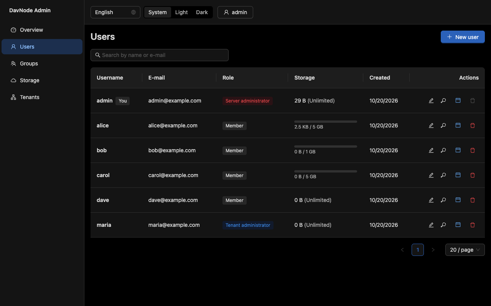</div>

It talks to the Admin API only, so everything it does is also possible with
`curl` — the UI adds no permissions of its own. It is available in English and
German, in a light and a dark theme (or following your system), and works on a
phone.

## Switching it on

Set an environment variable and restart:

| Variable                        | Default  | Meaning                                                                                                                         |
| ------------------------------- | -------- | ------------------------------------------------------------------------------------------------------------------------------- |
| `DAVNODE_ADMIN_UI_ENABLED`      | `false`  | Serve the UI at `/admin-ui/`.                                                                                                   |
| `DAVNODE_ADMIN_UI_CONTENT_VIEW` | `false`  | Let administrators read calendars and contacts of their users. Needs the variable above; the server refuses to start otherwise. |
| `DAVNODE_ADMIN_UI_DIR`          | built-in | A directory with another build of the UI. Only useful if you build it yourself.                                                 |

Then open `https://your-server/admin-ui/` (the server redirects `/` there
while the UI is on). The two variables are independent decisions: you can run
the UI for user and group management and still keep everybody's calendars and
contacts out of the administrators' reach.

When the UI is off, `/admin-ui/` answers `404` and nothing of it is read from
disk. When it is on but the build is missing (a custom image without it), the
server refuses to start and names the directory it looked in.

::: tip Try it
`docker compose -f docker-compose.demo.yml up --build` starts a throw-away
instance with the UI and sample data. Sign in at
`http://localhost:8080/admin-ui/` as tenant `demo`, user `admin`, password
`demo-admin-password`.
:::

## Signing in

<div class="screenshot only-light">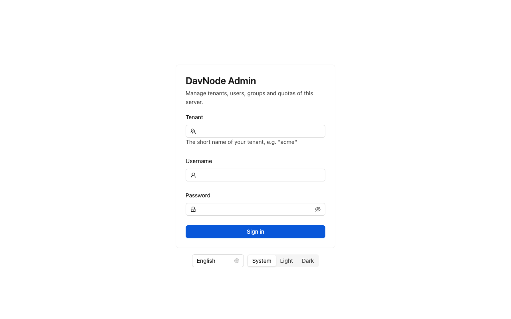</div>
<div class="screenshot only-dark">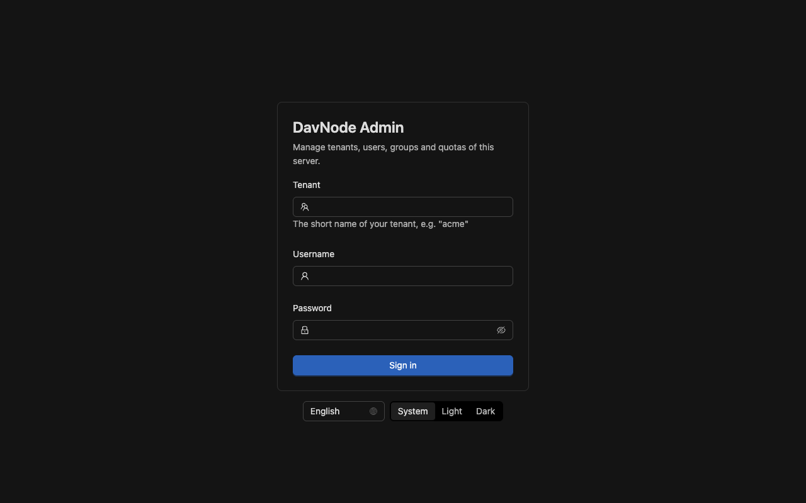</div>

Enter the **tenant** (its short name), your user name and your password — the
same credentials you use for the DAV endpoints. There is no separate account
system and no session on the server: the browser keeps your credentials for
this tab only and sends them with every request, like a `curl -u`. Closing the
tab signs you out.

What you may do depends on your role:

| Role                     | Sees                                                                                |
| ------------------------ | ----------------------------------------------------------------------------------- |
| **Server administrator** | Everything below, including the list of all tenants.                                |
| **Tenant administrator** | Users, groups, storage and (if enabled) calendars and contacts of their own tenant. |
| **Member**               | Nothing but a note that the area is for administrators.                             |

Users, groups and storage always belong to the tenant you **signed in to**,
because the Admin API addresses a tenant through the login. A server
administrator creates tenants on the _Tenants_ page; to manage the users of
another tenant, sign in to that tenant with one of its administrators.

## What you can do

**Overview** shows who you are and which authentication providers the server
runs (Basic, Digest, OAuth2 and the trusted OAuth2 issuers). Providers come
from the server configuration and cannot be changed here.

**Users** — search, create, edit (e-mail, role, storage limit), reset a
password, link an OAuth2 identity and delete. A tenant administrator cannot
grant or change the server administrator role, and the last server
administrator cannot be removed; the UI offers only what the API allows and
explains the refusals. Deleting asks you to type the user name.

**Groups** — create and delete groups, add and remove members (users and other
groups) and see the _effective_ members, including those of nested groups.

<div class="screenshot only-light">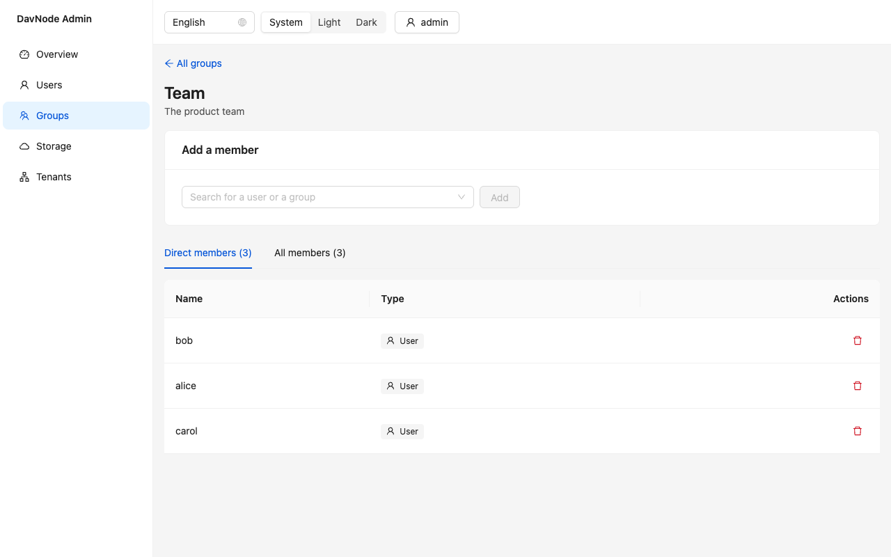</div>
<div class="screenshot only-dark">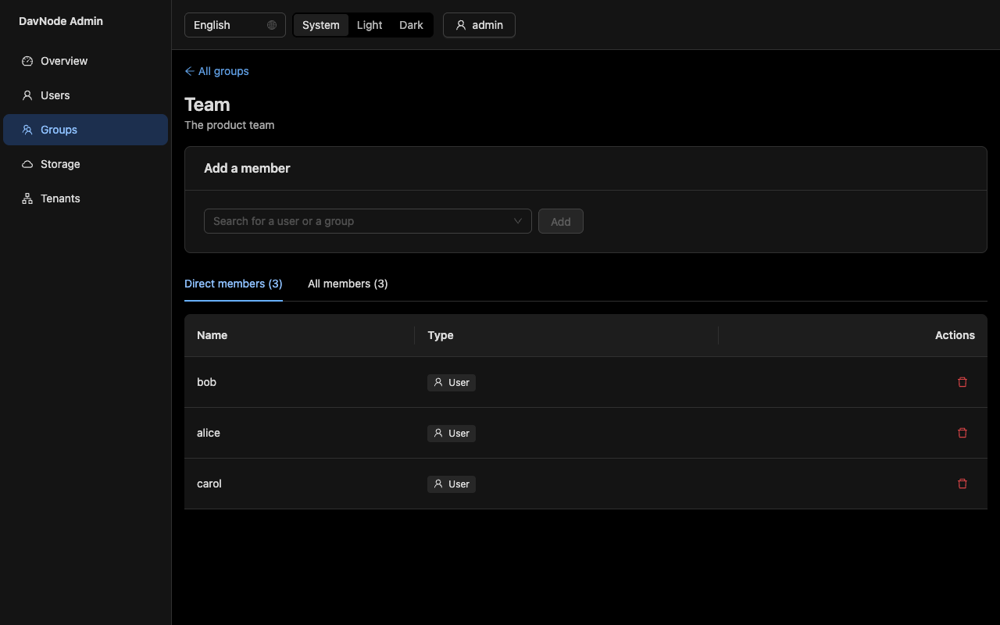</div>

**Storage** — use and limit of the tenant and of each user, change limits and
recount if the figures look wrong. Only a server administrator can change the
tenant limit.

**Tenants** (server administrators) — create, rename, set a storage limit and
delete. Deleting a tenant removes all of its users, files, calendars and
contacts; you have to type its short name to confirm, and you cannot delete
the tenant you are signed in to.

<div class="screenshot only-light">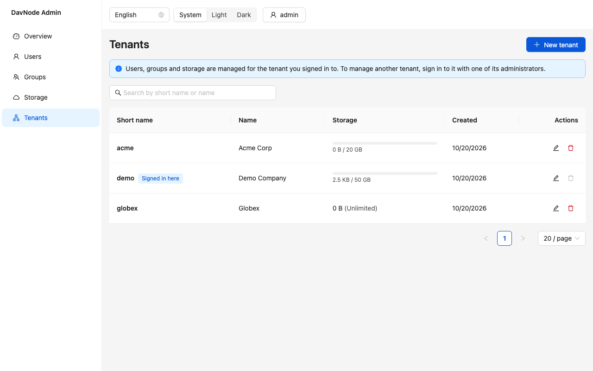</div>
<div class="screenshot only-dark">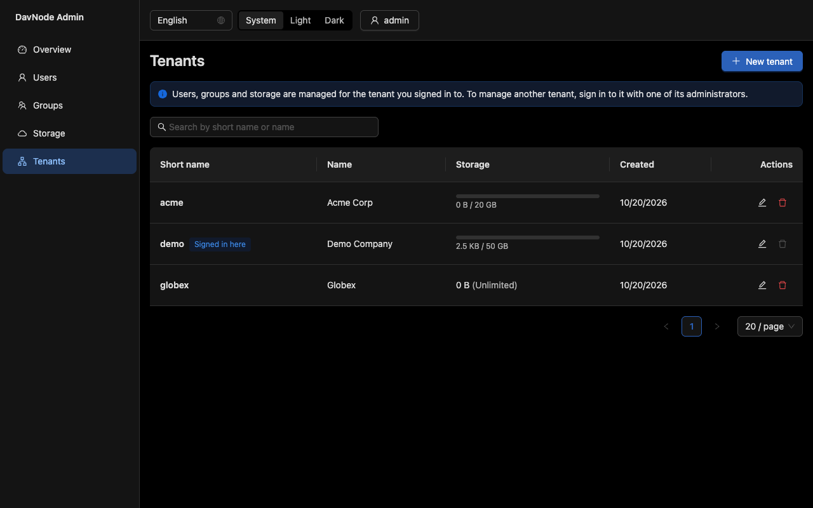</div>

## Looking into calendars and contacts

With `DAVNODE_ADMIN_UI_CONTENT_VIEW=true` every row of the user list gets a
calendar icon that opens that user's calendars and address books, **read-only**.
It exists for support cases ("my phone does not show the meeting"), not for
browsing.

<div class="screenshot only-light">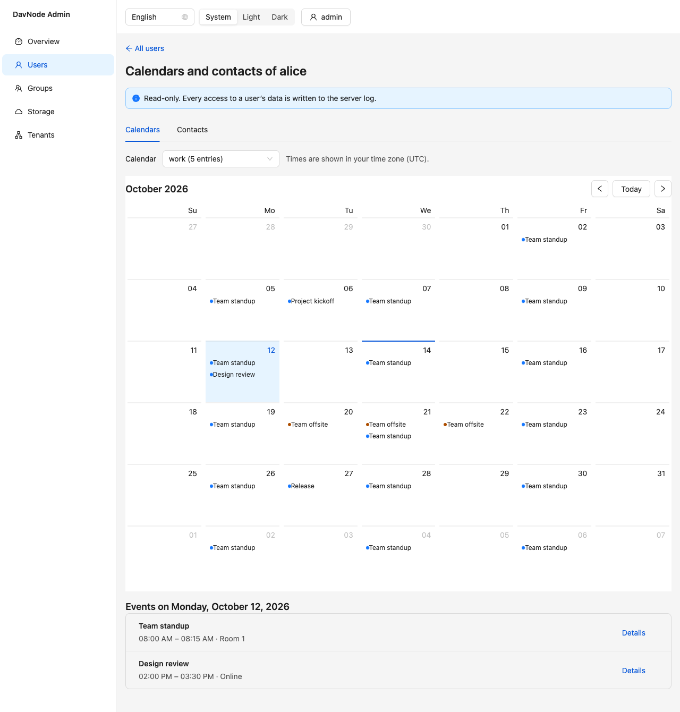</div>
<div class="screenshot only-dark">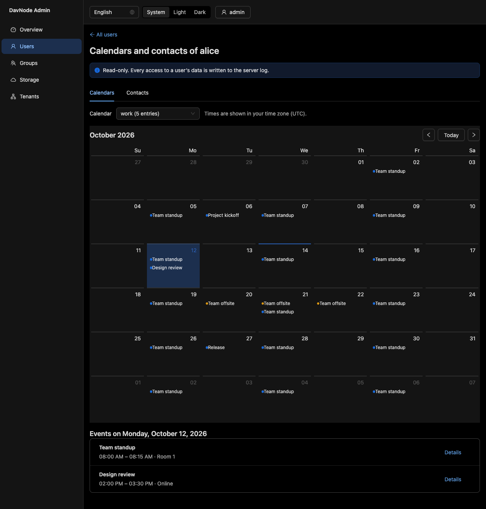</div>

- **Calendars** show a month view. Recurring events are expanded, all-day
  events stay on their dates in every time zone and times appear in your
  browser's time zone. Open an event for place, description, status and, on
  request, the stored iCalendar text.
- **Contacts** are a searchable, paged table; a contact opens with all its
  details and, on request, the stored vCard.
- Everything is shown as text. A title such as `<script>…</script>` is displayed
  literally and never runs.

::: warning Privacy
Administrators can read other people's data with this switched on. Every read
is written to the server log with the administrator, the user and what was
read — a line like

```json
{
  "message": "Admin read user content",
  "adminPrincipalId": "…",
  "targetUserId": "…",
  "tenantSlug": "demo",
  "resource": "events"
}
```

— but the content is not recorded. Tell your users, check that this fits your
data-protection rules, and keep the log. Leave the switch off if you do not
need it.
:::

<div class="screenshot only-light">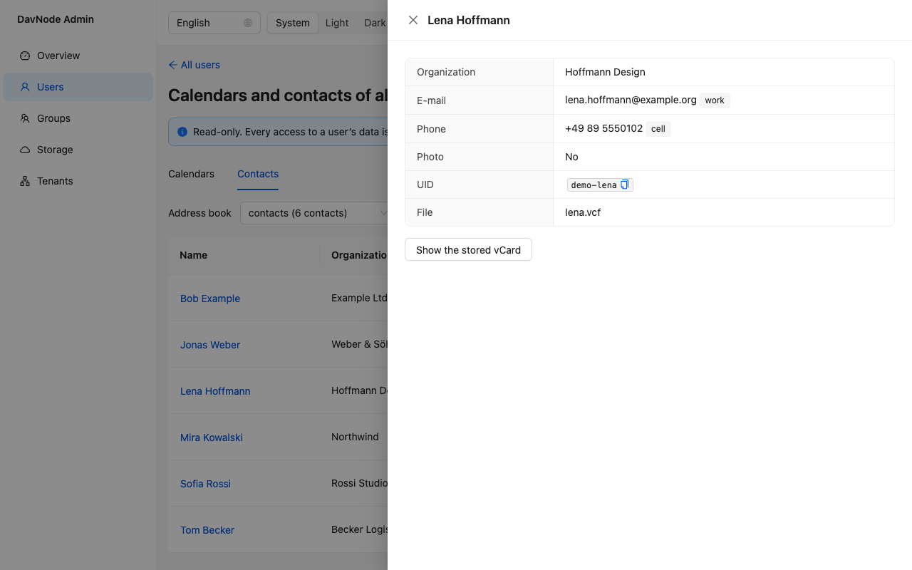</div>
<div class="screenshot only-dark">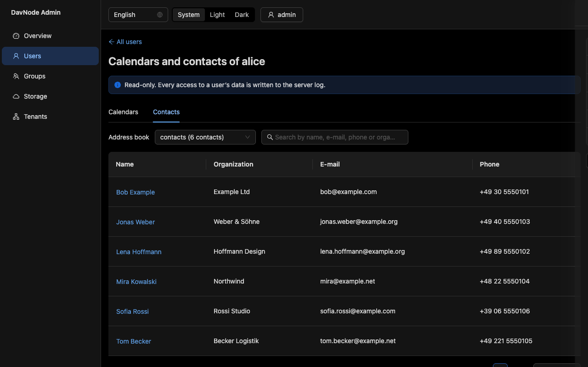</div>

## Language and theme

The language follows the browser (English or German) and can be changed in the
header; the choice is remembered. The theme can be _System_, _Light_ or _Dark_;
_System_ follows your operating system and switches live.

<div class="screenshot">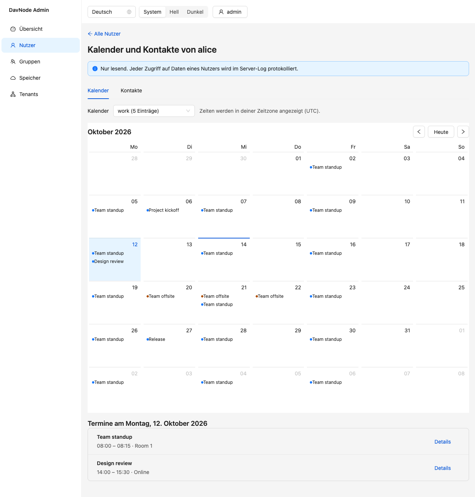</div>

## Security notes

- **Use HTTPS.** The credentials travel in the `Authorization` header of every
  request, as with any HTTP Basic client. The login page warns when it is
  opened over plain HTTP from another machine. See
  [Transport and headers](security.md#transport-and-headers).
- **Same origin, no cookies.** The UI is served by the server itself, so it
  needs no CORS, and without cookies there is nothing to forge across sites.
  Credentials live in the tab's session storage only; the password is never
  stored.
- **Content Security Policy** applies to `/admin-ui/` only: scripts, styles,
  images and requests are limited to the server's own origin and the page
  cannot be framed.
- **Rate limiting** counts failed sign-ins like any other client. Behind a
  reverse proxy set `DAVNODE_BEHIND_TLS_PROXY=true` so the real address is used.
- The UI lives at `/admin-ui/`; it cannot be moved to another path prefix
  behind a proxy.

## Troubleshooting

**`/admin-ui/` shows `404`.** `DAVNODE_ADMIN_UI_ENABLED` is not `true` for the
running container. Check with `docker compose exec app printenv | grep ADMIN_UI`.

**`/` shows `404`.** Expected while the UI is off: the server has nothing at
the root. With the UI on it redirects to `/admin-ui/`.

**The server will not start.** The message names the problem: the content view
without the UI, a value other than `true`/`false`, or a missing UI build.

**"The username or password is wrong" for a user who works with a DAV
client.** Check the tenant: the first field is the tenant's short name, not a
domain.

**"Too many failed attempts".** See the rate limit above; wait for the window
to pass or raise `DAVNODE_AUTH_RATE_LIMIT_*`.

**No calendar icon in the user list.** The content view is off, or you are
looking at a version without it.

## Building and testing it yourself

The UI is the package `packages/admin-ui` (React, Vite, Ant Design). The
release image already contains the build.

```bash
npm run build --workspaces          # builds the UI into packages/admin-ui/dist
npm run dev -w @davnode/admin-ui    # dev server on :5173, proxies /admin to :8080
npm test -w @davnode/admin-ui       # unit and accessibility tests
npm run test:e2e -w @davnode/admin-ui  # browser tests against a real server
npm run screenshots -w @davnode/admin-ui  # regenerates the images on this page
npm run generate:api -w @davnode/admin-ui # types from docs/admin-api.openapi.yaml
```

The API types are generated from the OpenAPI document and CI fails when they
differ. The tests fake the API but check every answer and request against the
same document, so the UI and the API cannot drift apart unnoticed.
